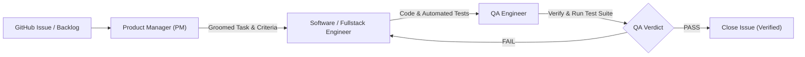

# AGENTS.md — AI Agent Guidelines & Operating Manual

Welcome to the **Economic & Credit Risk Dashboard (BCRA)** repository. This document defines the architectural rules, agent roles, engineering standards, and collaborative workflows expected of all AI agents working on this codebase.

---

## 1. Project Mission & High-Level Architecture

The goal of this project is to build an institutional-grade financial and credit risk dashboard powered by public data from the **Banco Central de la República Argentina (BCRA)** and complementary financial FX sources (DolarApi).

### Core Workflows:
1. **Macro & FX Monitor:**
   - Real-time and historical monetary aggregates, policy rates, international reserves, and inflation indices (CER, UVA, Badlar).
   - Financial exchange rates (Official vs. MEP / CCL / Blue) and FX spreads (*brecha cambiaria*).
   - Dynamic variable selector querying BCRA series catalogs.
2. **Credit Risk Screener (Central de Deudores):**
   - Single CUIT/CUIL lookup detailing 24-month debt classification history (*Situación 1 to 6*), bank debt distribution, and bounced checks (*cheques rechazados*).
   - Automated early-warning risk badge engine (credit deterioration, non-bank lender concentration, recent unpaid checks, debt acceleration).
3. **Batch Portfolio & Comparative Board:**
   - Multi-debtor assessment via CSV/TXT upload with client-side Módulo 11 CUIT validation and comparative risk sorting.
4. **Executive Reporting:**
   - Printable 1-page executive credit dossier with print stylesheets (`@media print`) and Excel/PDF export capabilities.

### Tech Stack:
- **Backend:** Python 3.11+, FastAPI, SQLite (SQLAlchemy / SQLModel), HTTPX (resilient client with custom SSL handling), Pytest, ReportLab / OpenPyXL.
- **Frontend:** React 18+, Vite, TypeScript, Tailwind CSS, Lucide React, Recharts.
- **Tooling & Orchestration:** Git, GitHub CLI (`gh`), Vitest / Pytest.

---

## 2. Repository Layout

```
economic-dashboard/
├── AGENTS.md                           # This operational manual
├── README.md                           # Human-facing project documentation
├── _docs/
│   ├── plan.md                         # Comprehensive architecture blueprint & data specifications
│   └── tasks.md                        # Implementation task backlog
├── .agent/
│   ├── agents/                         # Specialized persona definitions
│   │   ├── pm/agent.md                 # Task grooming & acceptance criteria
│   │   ├── software-engineer/agent.md  # General task implementation & testing
│   │   ├── backend-depeloper/agent.md  # Server-side API & DB engineering
│   │   ├── frontend-developer/agent.md # UI component & client state engineering
│   │   ├── fullstack-developer/agent.md# End-to-end integration
│   │   ├── qa-engineer/agent.md        # Acceptance criteria validation & QA verdicts
│   │   ├── debugger/agent.md           # Defect root cause analysis & fixes
│   │   ├── python-pro/agent.md         # Advanced Python patterns & performance
│   │   └── ui-desinger/agent.md        # UI/UX design & layout polish
│   └── skills/
│       └── design-dashboards/          # Dashboard design principles & references
├── backend/                            # FastAPI backend service
│   ├── app/
│   │   ├── main.py                     # App entrypoint
│   │   ├── database.py                 # SQLite models & session management
│   │   ├── clients/                    # External API clients (bcra_client, fx_client, mock_data)
│   │   ├── services/                   # Business logic (macro_service, risk_service, export_service)
│   │   └── routes/                     # REST API routers (macro, risk, export, system)
│   └── tests/                          # Backend test suite (pytest)
└── frontend/                           # React + Vite frontend
    ├── src/
    │   ├── components/                 # UI components (macro, risk, batch, layout, common)
    │   ├── services/api.ts             # Typed API client
    │   ├── types/index.ts              # TypeScript domain types
    │   └── App.tsx                     # Main layout & navigation
    └── package.json
```

---

## 3. Agent Roles & Collaboration Workflow

Every task follows a structured lifecycle to ensure zero regressions, complete acceptance criteria coverage, and robust test execution:



### Specialized Roles & Responsibilities:

| Role | Persona File | Primary Mandate |
|---|---|---|
| **Product Manager** | `.agent/agents/pm/agent.md` | Grooms issues, defines testable acceptance criteria, identifies edge cases, and sets explicit scope boundaries. Does not write code. |
| **Software Engineer** | `.agent/agents/software-engineer/agent.md` | Implements one task at a time strictly according to acceptance criteria, writes unit/integration tests, and commits work regularly. Leaves issues open for QA. |
| **Backend Developer** | `.agent/agents/backend-depeloper/agent.md` | Focuses on FastAPI endpoints, SQLite data access, BCRA/FX clients, SSL bypass/handling, caching logic, and error handling. |
| **Frontend Developer** | `.agent/agents/frontend-developer/agent.md` | Implements responsive React components, Recharts visualizations, Tailwind styling, Módulo 11 validation, and print stylesheets. |
| **QA Engineer** | `.agent/agents/qa-engineer/agent.md` | Tests implementation against criteria, runs tests, issues binary `## QA: PASS` or `## QA: FAIL`, and closes issues only on full verification. Never modifies code. |
| **Debugger** | `.agent/agents/debugger/agent.md` | Investigates test failures or runtime defects, identifies root causes, and implements minimal targeted fixes. |

---

## 4. Architectural Rules & Engineering Principles

### 1. Resilient External API Integrations & Offline Mock Mode
- Argentine government APIs (specifically `api.bcra.gob.ar`) frequently encounter custom or non-standard SSL certificate chains and intermittent downtime.
- **Rule:** All HTTP requests to external endpoints must utilize timeouts, graceful retry mechanisms, and custom SSL contexts.
- **Rule:** Always maintain comprehensive synthetic fallback data in `backend/app/clients/mock_data.py`. When offline or if an external API fails, the backend must seamlessly fall back to realistic mock payloads without crashing.

### 2. CUIT Validation Standard
- Every Argentine tax ID (CUIT/CUIL) submitted to single lookup or batch upload **must** be validated using the official **AFIP Módulo 11 checksum algorithm**.
- Validation must occur both client-side (for instant feedback) and server-side (for API defense).

### 3. Database & Caching Discipline
- The project uses **SQLite** for local storage and caching.
- Table schemas (`macro_series`, `macro_variables`, `cuit_cache`, `portfolio_items`) must be indexed on query keys (e.g., `variable_id + date`, `cuit`).
- Cached CUIT records prevent unnecessary repetitive hits to external services.

### 4. Financial Dashboard UX & Print Compliance
- Follow financial dashboard principles: clear metric hierarchy, color-coded risk alerts, and dual-axis comparison capability for related macro series.
- Credit ratings follow BCRA classifications (Situación 1 to 6). Use consistent severity colors (e.g., Green for Situación 1, Amber for 2-3, Red for 4-6).
- The 1-page executive credit dossier must support clean printing via `@media print` stylesheets and binary PDF/Excel downloads.

---

## 5. Definition of Done (DoD)

A task or GitHub issue is considered **Done** only when:
1. **Criteria Met:** Every acceptance criterion defined in the task is implemented.
2. **Automated Tests Passing:** Unit or integration tests are written and pass (`pytest` for backend, `vitest`/`tsc` for frontend).
3. **No Regressions:** Existing test suites continue to pass cleanly.
4. **Clean Git Commit:** Code is committed with conventional commit messages (`feat:`, `fix:`, `test:`, `docs:`, `refactor:`).
5. **QA Verification:** The QA engineer has executed the test suite, verified the criteria, and provided a formal `## QA: PASS` verdict.

---

## 6. Command Cheat Sheet

### Backend (FastAPI / Pytest):
```bash
# Run backend development server
uvicorn backend.app.main:app --reload --port 8000

# Run all backend tests
pytest backend/tests/ -v

# Run specific test file
pytest backend/tests/test_bcra_client.py -v
```

### Frontend (React / Vite / Vitest):
```bash
# Install dependencies
npm --prefix frontend install

# Start development server
npm --prefix frontend run dev

# Run TypeScript type-checking & build
npm --prefix frontend run build

# Run frontend tests
npm --prefix frontend run test
```

### GitHub Issues & Collaboration:
```bash
# List open issues
gh issue list

# View issue details
gh issue view <issue-number>

# Add progress or QA comment to an issue
gh issue comment <issue-number> --body "Comment text"

# Close verified issue
gh issue close <issue-number> --comment "Verified by QA - all acceptance criteria passed"
```
